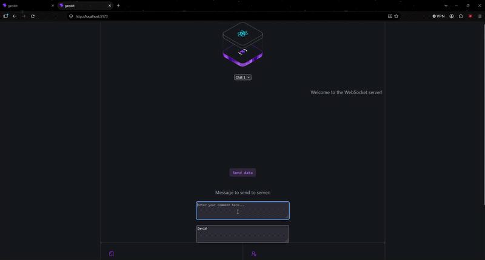

# SocketChat

A small learning project for experimenting with WebSockets, built with React and Node.js. Users pick a name, join one of several chat rooms, and send messages that are broadcast in real time to everyone connected. This was built as an exercise to understand how WebSockets work rather than as a finished chat application.

## Demo


## Features

* **Real-time messaging** – Messages are sent over a WebSocket and broadcast to every connected client
* **Multiple chats** – Switch between Chat 1–4; only messages for the selected chat are shown
* **Chat history** – On switching chats, the backend loads that chat's previous messages from PostgreSQL
* **Usernames** – Each message is tagged with the sender's name

## Technologies

### Frontend

* **React** – Component-based user interface
* **Vite** – Frontend build tool and development server
* **Browser WebSocket API** – Client-side socket connection
* **ESLint** – Code linting and quality

### Backend

* **Node.js** – Server-side JavaScript runtime
* **ws** – WebSocket server
* **Express** – HTTP server
* **pg** – PostgreSQL client for loading chat history
* **CORS** – Cross-origin resource sharing
* **Nodemon** – Auto-restart during development

## Architecture

```text
React + Vite
     │
     │ WebSocket (ws://localhost:8080)
     ▼
Node.js (ws) ───────────────► Broadcast to all connected clients
     │
     └──────────────────────► PostgreSQL (chat history)
```

## WebSocket Messages

| Type | Direction | Description |
| --- | --- | --- |
| `message` | Client → Server | Send a message with the user and chat name |
| `message` | Server → Clients | Broadcast of a new message to every client |
| `chat` | Client → Server | Request the history for the selected chat |
| `chat` | Server → Client | List of previous messages for that chat |

## Project Structure

```text
├── BackEnd/                 # Node.js backend
│   ├── main.js              # WebSocket server, Express server, DB queries
│   └── package.json
└── FrontEnd/Gambit/         # React frontend
    ├── public/              # Static assets
    ├── src/
    │   ├── components/      # ChatDisplay
    │   ├── service/         # WebSocket service and listeners
    │   └── App.jsx
    ├── package.json
    └── vite.config.js
```

## Running Locally

Requires Node.js and a local PostgreSQL database named `gambit` with a `messages` table (connection details are hard-coded in `BackEnd/main.js`).

```bash
cd BackEnd
npm install
npm run dev
```

```bash
cd FrontEnd/Gambit
npm install
npm run dev
```

The WebSocket server runs on `ws://localhost:8080`, the Express server on `http://localhost:3000`, and the Vite dev server on `http://localhost:5173`.

## Overview

This project of mine developed my understanding of the below:

* How WebSockets work and how they differ from request/response HTTP
* Running a WebSocket server in Node.js with `ws`
* Broadcasting messages to multiple connected clients
* Defining a simple message protocol with typed JSON payloads
* Registering and cleaning up socket listeners inside React `useEffect` hooks
* Loading data from PostgreSQL and sending it to the frontend over a socket
* Git-based development
